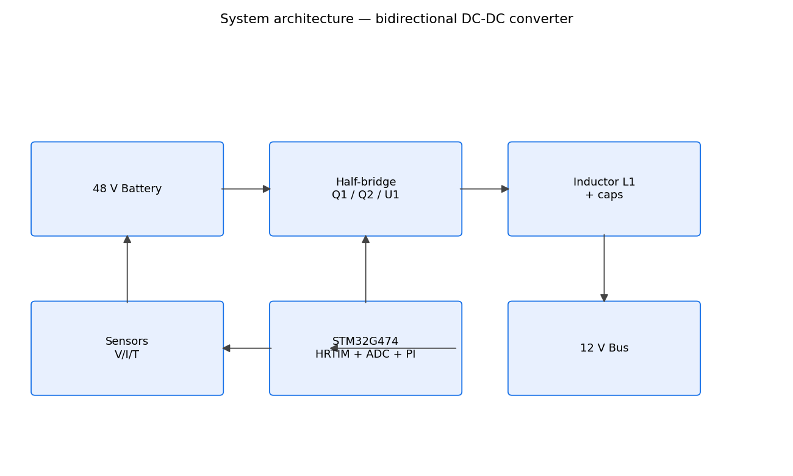

# Intelligent Bidirectional DC-DC Converter

A 1 kW, 48 V ↔ 12 V synchronous bidirectional DC-DC converter design
targeting EV 48 V mild-hybrid battery buses and 12 V loads, with
closed-loop embedded control, a complete protection strategy, thermal and
efficiency analysis, a software HIL testbench, and a KiCad PCB design.

> **Honesty statement:** this repository is a *design + simulation +
> software* project. No physical prototype has been built or measured.
> All quantitative results are CALCULATED, SIMULATED (analytical/LTspice
> netlist), SOFTWARE TESTED, or HIL/EMULATED.
>
> This repository represents an engineering design, simulation,
> software/HIL validation and PCB design workflow. Physical hardware
> fabrication and laboratory validation are future work.

## Problem Statement

EVs increasingly use both 48 V (mild-hybrid, starter-generator,
auxiliary) and 12 V rails. A one-way converter cannot recover energy when
charging the low-voltage bus from auxiliary sources, or support
V2G-style energy paths. A bidirectional converter solves this with one
magnetic and one switch pair.

## Engineering Objective

Design, model, and (software-)verify a bidirectional synchronous DC-DC
converter plus its control, protection, firmware structure, KiCad
schematic/PCB, thermal design, and documentation, such that a physical
prototype could be built from this repository with known-good
subsystems.

## System Architecture

```
                 ┌──────────────────────┐         ┌─────────────────────┐
 48 V battery ◄──┼── Q1 ──┬── L1 ── V12 ├────────►┼── 12 V bus / ECU   ◄┤
            └───────────┬──────┐         └─────────┴─────────────────────┘
                        │      │
                       SW     C12 (470 µF)
                        │
                       Q2
                        │
                       GND

  STM32G474 (HRTIM PWM + ADC) ──► U1 gate driver ──► Q1/Q2
      ▲        ▲        ▲
   V12 ADC   V48 ADC   IL ADC (INA240)   TMP ADC (NTC)
```



## Converter Topology

Synchronous half-bridge: Q1 (HS) and Q2 (LS) switch the switch node to
the 48 V rail or to ground. Inductor L1 couples the switch node to the
12 V rail. Synchronous rectification via both MOSFETs keeps conduction
loss low (Rds(on) ≈ 5 mΩ vs. a diode's ~0.5–0.7 V drop).

## Operating Modes

| Mode | Direction | Key relation |
|------|-----------|--------------|
| Buck | Battery → 12 V | D = V12/Vbat (≈ 0.25) |
| Boost | 12 V → Battery | r = 1 − V12/Vbat (≈ 0.75) |

## Power Stage

See `docs/POWER_STAGE_DESIGN.md`. Buck: ΔIL ≈ 4.1 A p-p, V12 ripple
≈ 21 mV (calculated). Boost: same ripple classification, higher
switching loss.

## Control Architecture

`docs/CONTROL_SYSTEM.md` — voltage-mode PI, duty feedforward,
anti-windup, ADC midpoint sampling, state machine
(IDLE/PRECHARGE/STARTUP/BUCK/BOOST/FAULT/SHUTDOWN), safe direction
change through IDLE.

## Embedded Firmware

`firmware/` — modular STM32G474 code: HRTIM complementary PWM with
200 ns dead-time, ADC sampling, sensor conversion, PI control, FSM,
protection, telemetry. **Logic-complete, not flashed.**

## PCB Design

`hardware/` + `docs/PCB_DESIGN.md` — 4-layer stackup (signal/GND/power/
signal), Kelvin current sensing, thermal vias, minimized commutation
loop. **Design only; DRC not run (future work).**

## Simulation

`simulation/` — `converter_model.py` (averaged analytical model),
`converter.cir` (LTspice netlist), `SIMULATION_RESULTS.md` (verification
matrix), efficiency sweep results in `results/`.

## Thermal Design

`docs/THERMAL_ANALYSIS.md` — per-device loss, Rth,JA requirements,
heatsink sizing. CALCULATED.

## Protection

`docs/PROTECTION_DESIGN.md` — OC (±90 A), OV (62/14.5 V), UV (32/9.5 V),
OT (85 °C), sensor-plausibility, startup, direction-change, shutdown,
recovery. Mirrored in `software/protection.py` and
`firmware/Protection/protection.h`.

## EMI/EMC

`docs/EMI_EMC.md` — loop minimization, gate control, decoupling,
filtering strategy, pre-compliance plan. No certification claimed.

## HIL Validation

`hil/` — software controller-in-the-loop (plant model + real controller
code). **Not physical HIL.** `docs/HIL_VALIDATION.md`.

## Results

- 31 pytest tests passing
- Efficiency: 94.9 % buck / 93.6 % boost @ 1 kW (CALCULATED)
- V12 ripple ≈ 21 mV (CALCULATED)
- Software HIL: buck and boost regulate, fault injection works
- Mock dashboard CSV: `data/telemetry_mock.csv`

## Engineering Challenges

- Synchronizing direction change and duty feedforward without transients
- Dead-time vs. body-diode loss trade-off
- High-current low-side conduction loss dominates buck mode — Q2 size
  is the thermal driver
- Averaged HIL vs. switching HIL fidelity limits

## Design Decisions

`docs/DESIGN_DECISIONS.md`.

## Limitations

- No physical prototype, measurements, or firmware flash
- LTspice/KiCad binaries unavailable in the build environment — netlist
  and DRC steps are documented as future work
- EMI/thermal numbers are analytical estimates

## Future Improvements

- Fabricate, instrument, and close the measurement loop
- Higher switching frequency with GaN devices
- Current-mode control or hysteretic variant for faster load response
- Full Switched-capacitor EMI filter validation

## Repository Structure

```
├── README.md            ├── LICENSE        ├── .gitignore
├── AGENTS.md            ├── FINAL_PROJECT_STATUS.md
├── docs/                # all engineering documents
├── hardware/            # KiCad project, BOM, PCB
├── firmware/            # STM32 modules (Core/Drivers/Sensors/Control/Protection/Communication/Tests)
├── simulation/          # analytical model, LTspice netlist, results doc
├── hil/                 # software HIL harness
├── software/            # sensors, PI, protection, FSM, dashboard
├── tests/               # pytest suite
├── data/                # mock telemetry CSV
├── results/             # efficiency sweep CSV/PNG
├── images/
└── scripts/
```

## Technologies Used

Python, NumPy, matplotlib, pandas (data), pytest, STM32G474 (target),
HRTIM, KiCad 8, LTspice, C (firmware), Tkinter dashboard.
